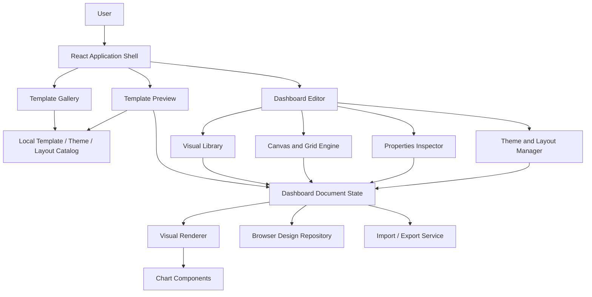

# Software Architecture
## BI Design Studio

**Version:** 1.0  
**Architecture style:** Modular frontend application, configuration-driven

---

## 1. Architecture overview

The MVP is a client-side web application. It has no required backend. Templates, themes, layout presets, and sample datasets are local application assets. User designs are persisted in browser storage.

The most important architectural principle is:

**A dashboard is a structured document, not a hardcoded page.**

The same dashboard document should drive:
- Gallery preview
- Template detail preview
- Editable canvas
- Saved design
- JSON export/import
- Future HTML or BI-platform export

## 2. High-level component diagram



## 3. Suggested source structure

```text
bi-design-studio/
├── public/
│   └── assets/
├── src/
│   ├── app/
│   │   ├── App.tsx
│   │   ├── routes.tsx
│   │   └── navigation/
│   ├── components/
│   │   ├── common/
│   │   ├── gallery/
│   │   ├── editor/
│   │   │   ├── EditorShell.tsx
│   │   │   ├── EditorToolbar.tsx
│   │   │   ├── VisualLibrary.tsx
│   │   │   ├── DashboardCanvas.tsx
│   │   │   ├── PropertiesInspector.tsx
│   │   │   ├── PagesPanel.tsx
│   │   │   └── LayersPanel.tsx
│   │   ├── visuals/
│   │   │   ├── VisualRenderer.tsx
│   │   │   ├── KpiVisual.tsx
│   │   │   ├── ChartVisual.tsx
│   │   │   ├── TableVisual.tsx
│   │   │   └── ...
│   │   └── themes/
│   ├── data/
│   │   ├── categories.ts
│   │   ├── templates/
│   │   ├── themes.ts
│   │   └── layoutPresets.ts
│   ├── domain/
│   │   ├── dashboard.types.ts
│   │   ├── visual.types.ts
│   │   ├── theme.types.ts
│   │   └── schemas.ts
│   ├── services/
│   │   ├── templateService.ts
│   │   ├── designRepository.ts
│   │   ├── importExportService.ts
│   │   └── idService.ts
│   ├── state/
│   │   ├── editorStore.ts
│   │   └── history.ts
│   ├── hooks/
│   ├── styles/
│   │   ├── tokens.css
│   │   └── global.css
│   └── main.tsx
├── tests/
├── docs/
├── package.json
├── tsconfig.json
└── README.md
```

Claude may adjust folder names, but preserve separation of domain model, catalog data, rendering, editor interactions, state, and persistence.

## 4. Key architectural modules

### 4.1 Catalog module
Responsible for:
- Categories
- Template definitions
- Theme definitions
- Layout presets
- Template search/filter

Catalog definitions are read-only source assets. Never edit them directly when a user customizes a template.

### 4.2 Dashboard document domain
Defines the canonical schema for dashboards, pages, components, grid settings, themes, and metadata.

All editor operations should produce valid document state.

### 4.3 Visual renderer
A registry maps each visual type to a renderer component.

Example concept:

```ts
const visualRegistry = {
  kpi: KpiVisual,
  bar: BarChartVisual,
  line: LineChartVisual,
  area: AreaChartVisual,
  pie: PieChartVisual,
  donut: DonutChartVisual,
  table: TableVisual,
  gauge: GaugeVisual,
  text: TextVisual,
};
```

Use a typed registry rather than large nested conditional statements.

### 4.4 Canvas / grid engine
Responsible for:
- Grid coordinates
- Drag and drop
- Move
- Resize
- Collision handling
- Selection
- Breakpoint preview

Use grid units in persisted data. Do not store screen pixel positions as the canonical layout.

### 4.5 Editor state
Responsible for:
- Active dashboard document
- Active page
- Selected component
- Current theme and overrides
- Undo/redo history
- Save state

Prefer immutable update functions. Keep state transitions centralized and testable.

### 4.6 Theme manager
Resolves theme tokens and applies them to all visuals. Component-level overrides, if supported, should be explicit and should not mutate the base theme.

### 4.7 Persistence repository
Expose a small interface so storage implementation can change later.

Example:
```ts
interface DesignRepository {
  list(): Promise<DashboardSummary[]>;
  get(id: string): Promise<DashboardDocument | null>;
  save(document: DashboardDocument): Promise<void>;
  delete(id: string): Promise<void>;
}
```

MVP implementation: IndexedDB or localStorage.

### 4.8 Import/export service
- Serialize valid dashboard documents to JSON.
- Validate imported documents.
- Check schema version.
- Enforce size and component limits.
- Return useful validation errors.
- Never execute content from imported documents.

## 5. Data flow

### Template to editor
1. User selects a template.
2. Catalog service retrieves immutable template definition.
3. Clone the dashboard document.
4. Generate new document, page, and component IDs as appropriate.
5. Set source template ID for traceability.
6. Load clone into editor state.
7. Save only the user's copy.

### Add visual
1. User drags or clicks a visual-library item.
2. Canvas determines a valid grid position.
3. Factory creates a component with default config and sample data.
4. State action inserts it into the active page.
5. Renderer displays it.
6. Inspector selects the new component.

### Edit visual
1. User selects a component.
2. Inspector reads selected component from document state.
3. User changes a property.
4. A typed state action updates that component.
5. Canvas and renderer re-render.
6. Autosave persists the updated document.

### Apply theme
1. User chooses a theme.
2. Theme manager updates document theme ID and any explicit overrides.
3. Renderer resolves new tokens.
4. Component data and layout remain unchanged.

## 6. State management and undo/redo

Use a central editor store or equivalent reducer.

Suggested actions:
- `loadDocument`
- `updateDocumentMetadata`
- `addPage`
- `renamePage`
- `duplicatePage`
- `deletePage`
- `addComponent`
- `updateComponent`
- `moveComponent`
- `resizeComponent`
- `duplicateComponent`
- `deleteComponent`
- `selectComponent`
- `applyTheme`
- `applyLayoutPreset`
- `undo`
- `redo`

Undo/redo should store meaningful document snapshots or reversible actions. Avoid adding history entries for every intermediate drag pixel; commit one history entry when the interaction completes.

## 7. Future evolution

Possible future phases:
- Backend API and cloud design storage.
- User accounts and team collaboration.
- AI design assistant that recommends templates.
- AI-generated dashboard composition from a business brief.
- Real data source connections.
- Power BI-oriented export or PBIP generation.
- Shared template marketplace.

Keep future services behind interfaces, but do not build speculative infrastructure in the MVP.
